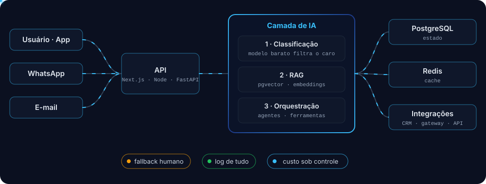

<div align="center">




<br/>

[](https://lucashsouza1941-eng.github.io/portfolio-lucas/)
[](mailto:lucashsouza.1941@gmail.com)


</div>


## 👋 Sobre mim

```ts
const lucas = {
  cargo:     "Full-Stack Developer @ Adalink (plataforma Adaflow)",
  freela:    "Sistemas sob medida para pequenos negócios e ONGs",
  foco:      "Aplicações web com IA integrada — do discovery ao deploy",
  agora:     ["ORION, meu assistente pessoal 24/7", "ATLAS, um Business OS multi-tenant"],
  bagagem:   "8+ anos em atendimento consultivo antes de migrar pra tech",
  diferencial: "Traduzir dor de negócio em escopo técnico viável",
  filosofia: "Código que ninguém usa não resolve problema nenhum.",
};
```


## 🚀 Projetos em destaque

<table>
<tr>
<td width="50%"><a href="https://lucashsouza1941-eng.github.io/portfolio-lucas/"></a></td>
<td width="50%"><a href="https://lucashsouza1941-eng.github.io/portfolio-lucas/"></a></td>
</tr>
<tr>
<td width="50%"><a href="https://lucashsouza1941-eng.github.io/portfolio-lucas/"></a></td>
<td width="50%"><a href="https://github.com/lucashsouza1941-eng/agenda-helaine"></a></td>
</tr>
<tr>
<td width="50%"><a href="https://github.com/lucashsouza1941-eng/regua-de-avaliacao"></a></td>
<td width="50%"><a href="https://github.com/lucashsouza1941-eng/site-costa-da-mina"></a></td>
</tr>
</table>

<details>
<summary><b>➕ Outros projetos</b></summary>
<br/>

| Projeto | O que é | Stack |
|---|---|---|
| 🏢 Painel Interno | Adiantamentos, VT, reembolso, contas a pagar, tarefas, agenda e chat | Next.js · Prisma · Auth.js |
| 🎨 [Jhonatham Cosmo](https://github.com/lucashsouza1941-eng/jhonatham-cosmo) | Portfólio de arte autoral com painel de admin | Astro · Keystatic |
| 💬 [Assistente RAG](https://github.com/lucashsouza1941-eng/Assistente-RAG) | Assistente para clínica odontológica com fallback humano | FastAPI · pgvector |
| 🤖 [LogiAgent](https://github.com/lucashsouza1941-eng/projeto-1-multi-agente-logistica) | Multi-agente para triagem de e-mails e relatórios | TypeScript · Prisma |
| 🧭 [Onboarding Tour](https://github.com/lucashsouza1941-eng/adalink-onboarding-tour) | Tour interativo da plataforma Adaflow | HTML · JS |

</details>


## 🧠 Como eu integro IA numa aplicação

<div align="center">

</div>

> **Na prática:** classificar antes de gerar (modelo barato filtra o caro), RAG pra resposta não alucinar,
> fallback humano quando a confiança cai — e log de tudo. IA em produção sem observabilidade é aposta.


## 🛠️ Stack

<div align="center">


<br/>


<br/><br/>


</div>


## 💼 Experiência

**Adalink — Desenvolvedor Full-Stack** · `abr 2026 — atual`
Plataforma **Adaflow**, SaaS multi-agente de IA, multi-tenant e em microsserviços.
Features ponta a ponta, busca semântica com pgvector, fluxos de RAG, refinamento de prompts,
stress test de agentes com datasets sintéticos e ADRs.

**Freelancer — Desenvolvedor Full-Stack** · `mar 2024 — atual`
Sistemas sob medida para pequenos negócios e ONGs — agendamento, sites institucionais,
painéis internos e automações com IA.


## 📊 GitHub

<div align="center">


<picture>
  <source media="(prefers-color-scheme: dark)" srcset="https://raw.githubusercontent.com/lucashsouza1941-eng/lucashsouza1941-eng/output/snake-dark.svg"/>
  <source media="(prefers-color-scheme: light)" srcset="https://raw.githubusercontent.com/lucashsouza1941-eng/lucashsouza1941-eng/output/snake.svg"/>
  
</picture>

</div>


## 🤝 Como eu trabalho

| | |
|---|---|
| 🔎 **Discovery primeiro** | Entender o processo antes de escrever a primeira linha |
| 📝 **Documentação junto** | README, ADRs e trade-offs escritos enquanto o código nasce |
| 🚢 **Entrega ponta a ponta** | Do banco ao deploy — não paro na feature |
| 📈 **Valor mensurável** | Se não reduz tempo, custo ou erro, é enfeite |

<div align="center">

### Bora construir algo que as pessoas usem?

[](https://lucashsouza1941-eng.github.io/portfolio-lucas/)
[](mailto:lucashsouza.1941@gmail.com)


</div>
